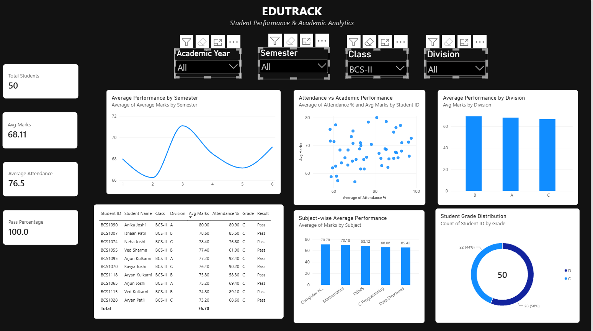

# 🎓 EduTrack – Student Performance & Academic Analytics Dashboard

## 📌 About the Project

EduTrack is an interactive Student Performance and Academic Analytics Dashboard developed using Microsoft Power BI.

The dashboard helps analyze academic performance, student grades, attendance and subject-wise results through interactive visualizations.

## 🎯 Project Objectives

- Analyze overall student academic performance.
- Monitor student attendance.
- Compare subject-wise performance.
- Understand grade distribution.
- Analyze academic performance across divisions and semesters.

## 🛠️ Tools & Technologies

- Microsoft Power BI
- Data Visualization
- Data Analytics
- MySQL (as applicable to the project)

## 📊 Dashboard Features

### Key Performance Indicators
- Total Students
- Average Marks
- Pass Percentage
- Average Attendance

### Visualizations
- Subject-wise Average Performance
- Student Grade Distribution
- Attendance vs Academic Performance
- Average Performance by Division
- Semester-wise Performance Analysis

### Interactive Filters
- Class
- Division
- Semester
- Academic Year

## 📁 Project File

`EduTrack.pbix`

Open the project using Microsoft Power BI Desktop.

## 👩‍💻 Developed By

**Sanskruti Somnath Supekar**

B.Sc. Computer Science Student  
Indira College of Commerce and Science  
Expected Graduation: 2027

## 📬 Contact

- Email: s20222715@gmail.com
- LinkedIn: https://www.linkedin.com/in/sanskruti-supekar-110275393/
- GitHub: https://github.com/SanskrutiSup

---

⭐ Thank you for visiting my project!

## 📸 Dashboard Preview

## 📊 Key Dashboard Metrics

- Total Students: 50
- Average Marks: 68.11
- Average Attendance: 76.5%
- Pass Percentage: 100%
